# How `erc_indoor` works, end to end

This is the full story of the NYU indoor track stack: what it is trying to do,
what it builds offline, what happens on every 250 ms tick during a live run,
and why each piece exists. Every number below comes from the code or from a
live run log. Where a design choice came from a failure, the failure is named
(the code comments say "run N"; those are the live test runs of 2026-09-22).

Contents

1. [The task](#1-the-task)
2. [The hardware reality that shapes everything](#2-the-hardware-reality-that-shapes-everything)
3. [Architecture at a glance](#3-architecture-at-a-glance)
4. [Offline: teaching the route](#4-offline-teaching-the-route)
5. [Online: starting a run](#5-online-starting-a-run)
6. [One control tick, in order](#6-one-control-tick-in-order)
7. [The perception and estimation pieces](#7-the-perception-and-estimation-pieces)
8. [The navigator state machine](#8-the-navigator-state-machine)
9. [Safety layers: everything that can stop the rover](#9-safety-layers-everything-that-can-stop-the-rover)
10. [What a run leaves behind](#10-what-a-run-leaves-behind)
11. [A real lap, tick by tick](#11-a-real-lap-tick-by-tick)
12. [Tuning knobs](#12-tuning-knobs)
13. [Tools](#13-tools)
14. [Known quirks and weak spots](#14-known-quirks-and-weak-spots)

---

## 1. The task

The course is a 132 m loop inside an NYU building (rules: `NYU Indoor - ERC 2026.pdf`
in this folder). It starts and ends at an orange cone and has four checkpoint
cones on the way:

> Start/Finish (orange) → east along the glass atrium through **CP1 (red)** →
> **LEFT** at the piano → north through **CP2 (blue)** to the chairs → **LEFT** →
> west through **CP3 (green)** → **LEFT** → south through **CP4 (yellow)** →
> **RIGHT** → stop at the orange cone (the last leg is only ~2–3 m).

What makes it hard:

- **No GPS** indoors (`/data` reports lat/lon = 1000) and **no SDK mission**: nothing
  is started, claimed or ended. Checkpoints are judged at the cones by people.
- **The compass is useless** indoors (swings ±200°).
- One attempt, no re-tries. Finishing the whole route is what counts; the cones
  only give partial credit if the rover doesn't finish.
- The long white corridors look almost identical to each other.

The approach is **visual teach-and-repeat**: a human drove the lap once (the
*teach* lap); the rover then repeats it by continuously answering two questions
against that recording:

1. *Where along the teach lap am I?* (a 1-D position, "metres of progress")
2. *Which way was the teach camera pointing here, relative to me?* (a heading error)

The cones are never navigation targets. The map is. The cone detector only
pauses for a cone sitting in the path and confirms the finish.

---

## 2. The hardware reality that shapes everything

These were measured on the unit (moto-stem-opal, an EarthRover Mini+) and they
explain most of the design:

| Fact | Value | Consequence in the code |
|---|---|---|
| Camera frame age | 0.6–1.3 s old when it arrives | Position is pushed forward by `speed × 0.8 s` before any decision (`LATENCY_S`). Obstacle distances are "what the camera saw ~0.35 m ago". |
| Command → motion lag | ~1.1 s | Turns are **open-loop spin pulses + a settle + a fresh look**, never a proportional loop at tick rate (that limit-cycled: KP 0.012 oscillated ±35° with a 10 s period). |
| Telemetry | rpm + gyro in 5-sample, 50 Hz bursts every ~0.5 s, each sample hardware-timestamped | Odometry de-duplicates by timestamp and integrates trapezoidally. |
| Wheel | 0.388 m per revolution (fitted so lap 1 = 132 m) | `lap.WHEEL_M_PER_REV` |
| Gyro z | left-positive, bias ≈ +0.27 °/s at rest | Re-measured at every start. Over 10 minutes the bias alone is ~160°, so yaw is only trusted over seconds (turn progress), never as absolute heading. |
| Camera | fx = 340 px at 1024 wide (~113° FOV), 0.148 m above the floor, pointing ~2.4° **up** | `camera_front.json`; every pixel↔floor-metre conversion goes through `calib.py`. |
| Skid steer | angular ≈ 0.03 doesn't move it (deadband); spins sometimes don't break stiction below 0.55 | Small integral term while driving; spins use `SPIN_ANG = 0.55`; a pulse that produced no rotation boosts the next one. |
| Body | 250 × 190 mm | Swept-path half-width 0.17 m for obstacle checks. |

The link path is also worth knowing, because it is where the latency comes from.
The local SDK (`earth-rovers-sdk/`, a FastAPI server) drives a headless Chrome that
joins the rover's Agora video and messaging channels. `GET /v2/front` returns the
last decoded video frame from that page (`getLastBase64Frame`), `GET /data`
returns the last telemetry message, and `POST /control` forwards
`{"linear", "angular"}` into the messaging channel. The Mini+ stops if commands
stop arriving, so commands have to be **streamed**, not sent once.

---

## 3. Architecture at a glance

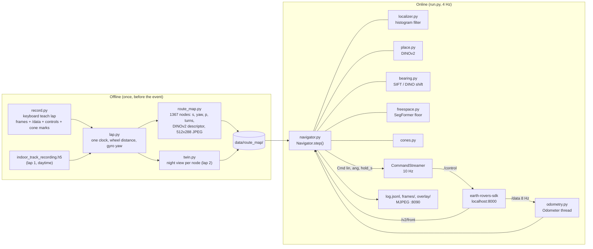

| File | Role |
|---|---|
| `run.py` | The entry point. Startup, the 4 Hz loop, link watchdogs, command streaming, logging, overlay. |
| `navigator.py` | All driving decisions. Pure logic, no SDK calls, so it can also be stepped from a recording. |
| `localizer.py` | "Where along the lap am I?" as a probability over the 1367 map nodes. |
| `place.py` | DINOv2 ViT-S/14: one place descriptor per image + the patch-token grid. |
| `bearing.py` | Heading error to a teach image: SIFT horizontal-shift vote, or DINOv2 patch-grid shift. |
| `freespace.py` | Where the floor ends in each direction (SegFormer-B2), and which headings are clear. |
| `cones.py` | Colour + geometry cone detector. |
| `odometry.py` | Background thread integrating wheel distance and gyro yaw from `/data`. |
| `calib.py`, `camera_front.json` | Camera model: pixels ↔ metres on the floor. |
| `sdk_client.py` | Thin HTTP client for the SDK. |
| `route_map.py`, `twin.py`, `lap.py`, `record.py` | The offline teach pipeline. |
| `overlay.py` | The annotated camera view (saved per tick, served live). |
| `replay.py`, `probe.py` | Offline check against a recording; a 1 m live calibration probe. |

---

## 4. Offline: teaching the route

### 4.1 Recording a lap

Two recordings exist, in two formats, and `lap.py` loads both into one shape
(`Lap`: frame times, a frame loader, wheel speed bursts, gyro bursts, commands,
cone-mark events), **on one clock**:

- **Lap 1** (`data/indoor_track_recording.h5`, daytime, 509 MB, not in git) is the
  teach lap the map is built from. Its frame clock runs exactly +4 h ahead of its
  IMU clock (the SDK stamps frames with `utcnow()` = local-as-UTC); `lap.py`
  subtracts 14 400 s. Its `controls` table is empty.
- **Lap 2** (`runs/indoor/lap_20260922_204027`, night, not in git) was recorded
  with `record.py`, which fixes both problems: everything is stamped with
  `time.time()` at receipt, every streamed command is logged, and a key press marks
  each cone as the rover passes it (`0` start/finish, `1`–`4` CP1–CP4).
  `record.py` polls `/v2/front` faster than the camera updates, so `lap.py` drops
  byte-identical consecutive frames (14 927 fetched → 3 430 unique).

Wheel distance is the trapezoidal integral of the burst-mean wheel speed
(`rpm/60 × 0.388 m`), **interpolated** between bursts, never sample-and-hold:
holding a burst taken while accelerating across a 3.6 s polling stall inflated
lap 2 from 125 m to 193 m. Gyro yaw is integrated the same way after
subtracting the median gyro rate while the wheels were still.

### 4.2 Building the route map (`route_map.py`)

```bash
python -m erc_indoor.route_map            # lap 1 -> erc_indoor/data/route_map
```

1. **Crop.** A `record.py` lap is cropped from the first to the last
   start/finish mark. Lap 1 has no marks; it began at the start cone.
2. **Thin** to ~4 frames per second (most consecutive frames are near-duplicates).
   The result is **1367 nodes over 131.8 m**, about one every 0.1 m.
3. For each node, store:
   - `s`: wheel distance from the start cone (m)
   - `yaw`: gyro yaw relative to the start (deg, left-positive; short-horizon only)
   - a 512 × 288 JPEG (`frames/NNNNN.jpg`) for heading matching
   - a 768-d DINOv2 descriptor (`desc.npy`, see §7.3)
4. **Detect turns** from the yaw rate: stretches turning faster than 1.5 °/s,
   merged across pauses of up to 15 frames (the teach turns came in bursts),
   kept if the total change is ≥ 40°. Result:

   | Turn | Nodes | At s | Teach angle |
   |---|---|---|---|
   | 1 (piano) | 427–459 | 33.0 m | L 80° |
   | 2 (chairs) | 730–784 | 63.6 m | L 96° |
   | 3 | 998–1054 | 97.2 m | L 50° (a slow ~2 °/s arc, so part of it falls outside the segment) |
   | 4 | 1275–1320 | 129.6 m | R 105° |

5. **Progress `p`.** The teach rover turned **in place**: at turn 1, `s` stays at
   33.0 m for 30 frames while yaw rises 85°. Distance alone can't say where in a
   turn the rover is, so progress counts turned degrees too:
   `p = s + 0.02 m/deg × (degrees turned inside turn segments)`. A 90° corner
   counts as 1.8 m. `p` is strictly increasing (138.7 at the end), which makes it
   usable as the filter's coordinate.
6. **Checkpoints** are labels only: `CP1 17.5, CP2 47.0, CP3 84.0, CP4 111.0`,
   finish `131.8` (m of `s`). They were measured by replaying lap 2's cone marks
   against this map and adding 1.5 m (each key was pressed with the cone still
   just ahead). Navigation never depends on them; they drive the log labels, the
   progress bar and `STOP_AT_S`.

Everything goes in `data/route_map/meta.json` (+ `desc.npy`, `frames/`).

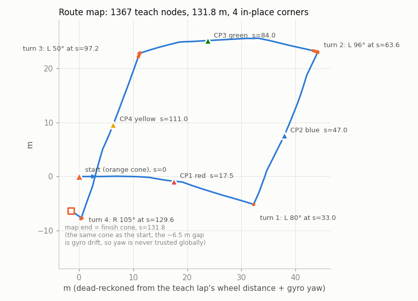

The sketch above is dead-reckoned from the map's own `s` and `yaw`. Start and
finish are the same cone, yet the drawn loop misses closing by ~6.5 m. That is
the gyro drift, and it is exactly why yaw is only ever used over a few seconds.

### 4.3 Night views (`twin.py`)

At night the glass atrium looks nothing like the daytime map (black windows
instead of bright ones) and SIFT finds 0–3 matches there. Lap 2 was driven at
night along the same route, so `twin.py` gives each map node a second picture:

1. Run lap 2 through the same localizer the live loop uses, so each lap-2 frame
   lands on a map node.
2. Keep only frames taken while **driving straight**: no spin commanded in the
   ~2 s before (allowing for the 1.2 s command lag). A frame grabbed
   mid-correction faces the wrong way and would steer the rover off course.
3. Each map node gets the nearest eligible lap-2 frame within 20 nodes (~2 m).

Coverage is **93 %** of nodes. The twin has its own `desc.npy` and `frames/` under
`data/route_map/twin/`. Everything downstream takes the **better of day and night**:
the localizer uses the max similarity, and the heading uses whichever view gives
more agreeing SIFT matches. `USE_TWIN=0` turns it off.

| Node 100, day (teach map) | Node 100, night (twin) |
|---|---|
| 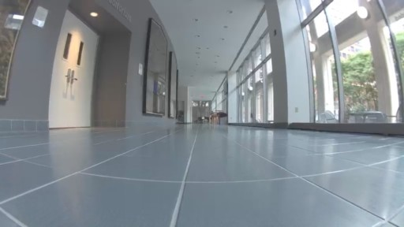 | 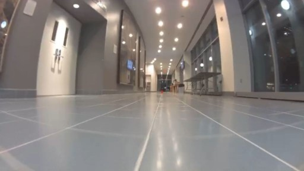 |

The competition runs in daylight, so the day map is primary there. At night
(where all the testing happened) the twin carries most of the load: in the best
run, 742 of the DRIVE ticks steered off a night view and 275 off a day view.

---

## 5. Online: starting a run

```bash
SEND_CONTROL=0 python -m erc_indoor.run   # dry run: localize + log, no motion
python -m erc_indoor.run                  # the lap
START_S=34 python -m erc_indoor.run       # start mid-route (after the piano turn)
```

Put the rover at the orange cone facing down the glass atrium, windows on the
**right**, the way the teach lap began. `run.main()` then does, in order:

1. **Load the stack** (`build_stack`): the route map, DINOv2 (warmed up on
   node 0 so the first real tick isn't slow), the localizer, reset to a Gaussian of
   σ = 3 m around `START_S` (default 0), the cone detector, and SegFormer (also
   warmed up).
2. **Build the navigator.** If `START_S` was given explicitly, it becomes
   `start_p`, and every corner behind it is marked done no matter what the first
   uncertain estimate says (run 4 re-ran turn 1 because the first estimate landed
   inside the turn segment).
3. **Wait for the SDK** HTTP server (30 s), then send a stop.
4. **Start the `Odometer` thread** and wait until wheel + gyro samples and a front
   frame arrive (60 s). If `/data` answers 400, the SDK is waiting for a mission:
   the message tells you to remove `MISSION_SLUG` from `earth-rovers-sdk/.env`.
5. **Measure the gyro bias** for 3 s (the rover must be still): the median raw
   gyro z while the wheels read zero, accepted if under 3 °/s.
6. **Start the `CommandStreamer`**, create `runs/indoor/run_<stamp>/`, start the
   overlay server on port 8090, open `log.jsonl`, trap Ctrl-C / SIGTERM.
7. Enter the loop.

**Why a separate command streamer.** Perception takes 250–450 ms per tick, and a
spin burst must last *exactly* its planned duration regardless. So the navigator
only *sets* a command with an expiry (`Cmd.hold_s`), and a 10 Hz thread keeps
posting it to `/control` until it expires, then posts zeros. If the decision loop
hangs, the rover stops within the hold time (at most 0.6 s for driving commands).

---

## 6. One control tick, in order

The loop runs at `CTRL_HZ = 4` (the best run held a median of 253 ms per tick).

**In `run.py`, before any decision:**

1. Fetch the front frame (3 s timeout) and the latest odometry state.
2. **Link checks.** If there is no frame, the fetch took longer than 4 s, or the
   odometry is older than 2.5 s while we are commanding motion: hold zero and
   retry in 0.3 s. Separately, a 64 × 36 grey thumbnail is compared with the last
   one: if neither the image nor the odometry has changed for 4 s while commanding
   motion, hold zero (run 4: the bot stopped answering and the loop kept deciding on
   a frozen image). Resume when data flows again.
3. Pack `Obs(now, frame, odometer s, odometer yaw, wheel speed)` and call
   `nav.step(obs)`. Any exception halts the rover and logs `ERROR`.
4. Hand the returned `Cmd(lin, ang, hold_s, mode, note)` to the streamer.
5. Log a JSON line, render the overlay, save every 2nd frame, stop on `DONE`, on
   `STOP_AT_S`, or after `MAX_RUN_S` (1500 s).

**Inside `Navigator.step`:**

1. **Odometry progress.** `dp = Δs + 0.02 × |Δyaw|` if yawing faster than 1.5 °/s
   (same units as the map's `p`), clipped to what the rover can physically do
   (0.9 m/s). If the tick gap exceeds 2 s the loop stalled: ignore odometry across
   the gap and flatten the belief so vision can re-localize.
2. `localizer.predict(dp)`.
3. Unless a spin burst is in progress (motion blur), encode the frame with DINOv2
   and `localizer.update(descriptor)`.
4. `localizer.constrain(window)`: belief outside the corner-sequence window is
   removed (§7.4).
5. Read the estimate and push it forward by `max(v, 0) × 0.8 s` of latency.
6. Log any checkpoint passed.
7. Run the current mode (§8), which returns the command.

---

## 7. The perception and estimation pieces

### 7.1 Odometry (`odometry.py`)

A daemon thread polls `/data` at 8 Hz. Each payload carries the last few
`rpms` rows `[fl, fr, rl, rr, t]` and `gyros` rows `[x, y, z, t]`. New samples
(by hardware timestamp) are integrated trapezoidally: wheel speed = mean of the
four rpms / 60 × 0.388 m, yaw rate = gyro z − bias. Integration steps are capped
at 0.6 s: full-lap run 3 had a ~100 s SDK stall, and joining the samples on
either side of it invented 29 m of travel that fired turn 3 in the wrong corridor.
`state()` returns cumulative `s`, `yaw`, current `v`, the newest hardware
timestamp and its age.

### 7.2 Camera geometry (`calib.py`, `camera_front.json`)

A pinhole model: fx = fy = 340, principal point at the centre of 1024 × 576,
height 0.148 m, pitch −0.041 rad (≈ 2.4° up). fx came from closing a 360° spin
(226-inlier loop closure); the pitch from where SegFormer's floor ends in long
corridors (rows 150–155 of 288 → horizon ≈ row 151 at 288 px). With the older
3°-down pitch every floor distance came out ~2× too short.

`image_to_ground(u, v)` intersects a pixel's ray with the floor plane and returns
robot-frame metres (x forward, y left). Rays at or above the horizon are marked
invalid instead of returning a huge distance. Free space, cones and the overlay
all use this.

### 7.3 Place recognition (`place.py`)

DINOv2 ViT-S/14, loaded from the local torch-hub cache. The frame is resized to
224 × 392 (16 × 28 patches, keeping 16:9) and normalized. From one forward pass:

- **Descriptor (768-d):** L2-normalized CLS token ⊕ L2-normalized GeM (p = 3)
  pooling of the patch tokens, normalized again. Used by the localizer.
- **Patch grid (16 × 28 × 384):** normalized patch tokens. Used as a heading
  fallback (§7.5).

It runs on MPS on the Mac (CUDA or CPU elsewhere).

### 7.4 The localizer (`localizer.py`)

A **1-D histogram filter** over the 1367 nodes, indexed by progress `p`.
Single-frame retrieval would jump between the look-alike white corridors (teach
frames 800–1100). Odometry is good to a few percent over tens of metres and
carries the estimate through aliased stretches; place recognition pins it down
wherever the view is distinctive (atrium, piano, chairs, exit signs).

| Step | What it does |
|---|---|
| `reset(p0, σ)` | Gaussian belief around the start. |
| `predict(dp)` | Shift every node's mass forward by `dp`, spread with σ = 0.15 m + 0.15 × \|dp\|, plus a tiny uniform floor (1e-5) so no place becomes impossible. |
| `update(desc)` | Similarity to every node = dot product (max of day and night descriptor). Likelihood = `exp((sim − max_sim) / 0.02) + 0.05`. The **0.05 floor** means one bad match can only dent the belief, never erase the true position. |
| `constrain(lo, hi)` | Multiply mass outside the window by 1e-9. The navigator's window is [end of the last completed corner − 3 m, end of the next corner + 8 m]. Live run 8: at the turn-4 doorway the filter jumped from s = 130 to s = 33.6 (the piano doorway looks alike) within seconds. After corner k, the rover can't be before it. |
| `anchor(p, σ)` | Soft prior after an event we *know* happened: a completed corner anchors at its end + 0.2 m with σ = 1.5 m. |
| `estimate()` | Peak node, mean and std within ±5 m of it, plus `20 × (mass outside that window)` as extra spread, so a two-humped belief reports itself as uncertain. |

In the best run the reported spread had a median of 0.43 m. The wheels ran
147.3 m while the map progress was 131.8 m (reversing, detours, spins and
slip), which is why the visual correction matters.

### 7.5 Heading error (`bearing.py`, `Navigator._heading`)

Given the live frame and a teach node, how many degrees is the live camera
rotated from the teach camera? Sign: positive = live points **left** of teach,
so the rover should turn right.

**SIFT vote (primary, BearNav-style).** Both images go grey → 512 × 288 → CLAHE
→ SIFT (≤ 1000 keypoints). Matches pass Lowe's ratio test (0.8) and must shift
vertically by less than 24 px. A pure yaw rotation shifts every feature by about
the same horizontal amount, so the heading is the **mode** of the horizontal
shifts: a 4 px histogram, smoothed, peak, then the median of the matches within
±10 px of the peak, converted with `atan(dx / fx)`. The mode, not the mean,
because matches on near-floor tiles and reflections disagree with the far
corridor and have to be outvoted. Accepted with ≥ 12 inliers and ≥ 20 %
agreement. Day and night reference views are both tried; the one with more
inliers wins.

**DINOv2 patch shift (fallback).** When SIFT fails (run 3: 3–9 inliers on the
plain walls at the piano doorway), slide the live 16 × 28 patch grid over the
reference grid by −10…+10 columns and score the mean patch similarity at each
shift. The best shift with sub-column parabolic refinement × 6.1°/column is the
heading. The "margin" (best score − median score) must be ≥ 0.10 (≥ 0.12 inside
turns; 0.08 once followed a wrong-way view). Validated against SIFT on the teach
corners: +24.0 vs +22.2, −13.1 vs −13.1.

If neither works the heading is `None`, and the navigator counts toward SEARCH.

### 7.6 Free space: where does the floor end? (`freespace.py`)

Run 3 drove straight into the wall beside the piano-corridor doorway: the heading
matched the teach lap perfectly, but the rover was offset sideways and nothing
looked at what was actually in front. This module does.

1. **Segment the floor.** SegFormer-B2 (ADE20K) at 512 × 288; floor = classes
   *floor* (3) and *rug* (28). Two morphological closes: a small one so grout
   lines don't end the floor, and a tall thin one (14 rows) so a **thin band of
   non-floor with floor beyond it** (a door threshold, a seam, a mat edge) is not
   an obstacle. The CP4 doorway threshold once read as "floor ends 0.4 m" five
   times and boxed the rover in.
2. **Boundary per column.** Scan each column up from the bottom (skipping 4 rows of
   lens vignette) to the first non-floor pixel. That row is where something stands
   on the floor.
3. **Obstacle feet.** Each boundary pixel below the horizon → a point on the floor
   in robot metres via the calibration. Columns where the floor reaches the horizon
   contribute nothing.
4. **Swept-path clearance per heading.** For headings −50°…+50° in 5° steps, the
   clearance is how far the rover can drive before a foot enters its 0.34 m-wide
   strip along that heading (capped at 5 m). Full-lap run: the rover clipped the
   piano-corridor doorframe ~6 times because the old ±7.5° "ahead" wedge missed a
   pillar edge 0.2–0.3 m off the front corner. `ahead_m` = clearance at 0°.
5. **`steer(want, need)`**: the heading nearest `want` whose clearance ≥ `need`,
   or `None`.

Why not metric depth: Depth Anything V2 on a camera 15 cm above a polished floor
read the floor ~16× too far (it sees the ceiling reflected) and put a wall 2.3 m
away one second before touching it. The floor boundary needs no depth scale at all.

### 7.7 Corridor following

Live run 5 (CP2 corridor): the teach bearing was biased ~20° toward the right
wall (near-wall features shift with sideways offset, not just heading) and needed
four obstacle stops. The direction in which the floor runs *farthest* tracks a
corridor's vanishing point to 5–10°. So when the view is a corridor, the rover
steers down it and the teach heading only chooses which opening:

- **It's a corridor** if the farthest clearance is ≥ 3 m and only 1–9 heading
  bins (≤ ~45°) reach 3 m.
- **The corridor heading** is the median of the bins reaching ≥ 90 % of the
  farthest clearance that are within 35° of the teach heading.

A visible corridor also counts as "having a heading" for the never-drive-blind
rule. Corridor steering was active in 792 of the best run's 1387 ticks.

### 7.8 Cones (`cones.py`)

Colour alone is useless in this building: orange doors, blue recycling bins, a
green bin, red EXIT signs and a yellow floor cable all pass a hue test, and the
polished floor mirrors tall things into cone-like blobs. So a cone is a
**saturated blob with cone geometry**:

1. HSV at 512 × 288, saturation ≥ 120, value ≥ 55; hue bands red (0–12 and
   168–180, which also covers orange, since the two can't be separated by hue),
   yellow 18–38, green 60–95, blue 100–125. Open, connected components, area ≥ 40 px.
2. Keep blobs with height/width 0.8–4.5 that don't touch the side edges.
3. **Taper:** the top fifth must be narrower than 60 % of the widest row. Bins,
   doors and their reflections are rectangles.
4. **Floor contact:** the base must be below the horizon. Signs have none.
5. **Size:** the base pixel → floor distance → real height must be 0.07–0.30 m
   (the cones are ~15 cm). A blob cut off by the bottom edge is kept as "very close".

Each cone comes back with x (forward), y (left), distance and bearing.

---

## 8. The navigator state machine

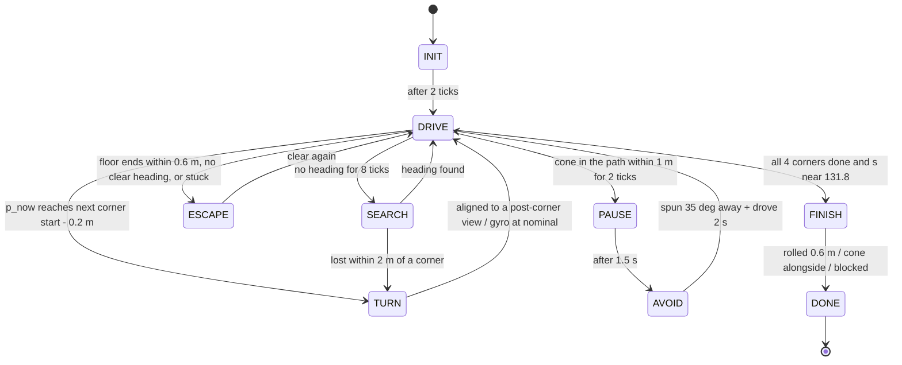

Corners are taken **strictly in order** (`turn_k`), so a corner can never be
skipped or repeated.

### Spin pulses: how every in-place rotation is done

With ~1.1 s of lag, a proportional spin controller oscillates. So every
rotation (corners, realigning, facing a gap, search, cone sidestep) is a **pulse**:

1. Duration = `boost × |degrees| / spin_rate`, clipped to 0.5 s (below that it
   often didn't break stiction)…2.5 s (1.5 s inside TURN). Angular = ±0.55.
2. **Burst** for that duration (no DINOv2 update: motion blur), then **settle**
   1.4 s at zero so the next frame is fresh and still.
3. Measure again, and pulse again if needed.

The spin rate starts at 25 °/s and is **learned visually**: when two consecutive
measurements use the same reference node, the change in heading error is the
rotation that pulse produced (the gyro barely samples a 1 s spin: camera +23.9°
vs gyro +6.8° in the live probe). New rate = average of old and measured, clipped
to 8–35 °/s. A pulse that produced < 3° of rotation multiplies the next one by
1.5 (up to 3×) to break stiction.

### INIT

Two ticks at zero to let the filter settle, then switch to DRIVE and mark corners
already behind the start as done.

### DRIVE: following the teach lap

Each tick, in this order:

1. **Corner or finish due?** If all four corners are done and `s ≥ 131.5` → FINISH.
   If `p_now ≥ p(next corner start) − 0.2 m` → TURN.
2. **Cone check.** A cone less than 1.0 m ahead and within ±0.25 m of the path
   for 2 consecutive ticks → PAUSE (the frames are ~1 s old, so "0.45 m ahead" is
   already under the bumper).
3. **Reference view** = the node 1.0 m of progress ahead of the estimate, never
   past the next corner's start. Heading error `e` from §7.5; the target heading is
   `want = −e`.
4. **Free space.** Floor ends < 0.6 m straight ahead → ESCAPE.
5. **Never drive blind.** No heading and no visible corridor for 8 ticks (~2 s) →
   SEARCH.
6. **Corridor override:** if in a corridor, `want` = the corridor heading.
7. **Avoidance:** if `want` isn't clear for 1.2 m, steer to the nearest heading
   that is (else one clear for 0.8 m, else ESCAPE: "no clear heading in view").
8. **Big errors are fixed in place, not by arcing.** If |want| > 30°, or we're
   avoiding, the gap is ≥ 8° off and the way ahead is < 1.2 m: stop and pulse
   `0.8 × want` ("realign" / "face gap"). In doorways a gentle arc kept clipping the
   jamb.
9. **Steering while rolling:**
   - corridor or avoidance: angular = 0.006 × (low-pass of `want`), ×1.5 while
     avoiding;
   - following the teach view: PI on the low-passed error, angular =
     −0.006 × e + I, where I integrates −0.0015 × e × dt, clamped to ±0.10 (a steady
     −5° error once persisted for 10 m because tiny angulars sit in the skid-steer
     deadband);
   - no heading: half of last tick's angular.

   The low-pass (α = 0.5) and a ±0.10 per-tick rate limit on angular come from
   ERC-3's indoor controller; they keep ~1.2 s of dead time from turning steering
   into a limit cycle. Angular is capped at ±0.25.
10. **Speed:** 0.45 × (1 − |want|/45, clipped to 0.4…1), at least 0.28. Drop to 0.30
    when the spread is > 3 m, there's no heading, we're avoiding, or the next corner
    is < 2.5 m away. Between 1.6 m and 0.6 m of free floor, scale down linearly
    (never below 0.28).
11. **Stuck watchdogs:**
    - *hung up*: over 4 s the wheels ran > 1.5 m, the visual position moved
      < 0.25 m **and** the image was nearly frozen → ESCAPE with a forced reverse
      (run 6: hung on a floor cable, wheels ran 11 m while the view stayed put for
      20 s; the image test stops false alarms where vision merely lags);
    - *no progress*: commanded forward but < 0.15 m of wheel distance in 6 s → ESCAPE.
12. Command `(lin, ang)` with a 0.6 s hold.

| Corridor following (s = 50.6 m) | Doorway avoidance right after turn 1 |
|---|---|
| 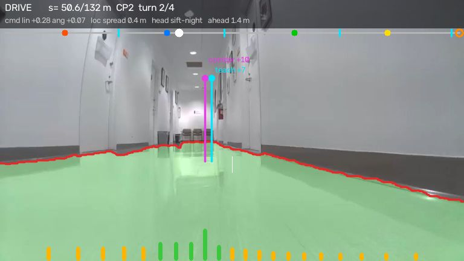 | 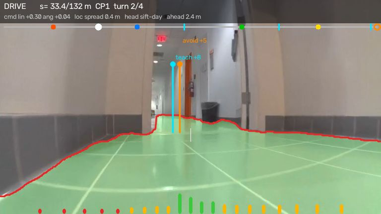 |

Left: magenta = corridor axis (+10°), cyan = teach heading (+7°). The fan at the
bottom is the clearance per heading: only the centre is green, i.e. a corridor.
Right: the teach heading (+8°) would clip the wall, so an avoidance heading (+5°,
orange) that is clear for 1.2 m is used instead.

### TURN: taking a corner

The teach rover turned in place at every corner, so the repeat does too.

1. **Entry.** The nominal angle is the teach angle, raised to at least 75° (every
   corner is ~90°; turn 3's teach segment only measured 50°). Record the gyro yaw
   and fire an **open-loop pulse of 65 %** of the nominal angle (turn 1:
   80° × 0.65 = +52°).
2. **After each settle, look for a lock** on the teach views 0.8, 2.0 and 3.5 m
   past the corner's end. The first that gives a heading within ±45° (SIFT, else
   DINOv2 with margin ≥ 0.12) is the lock.
3. **Locked:** learn the spin rate (§ above). Within ±7° → done. Otherwise pulse
   80 % of the remaining error (undershooting costs a pulse; overshooting costs a
   settle *and* a pulse back).
4. **No lock:** fall back to the gyro integrated over the whole turn (reliable over
   a full turn even though it isn't over a 1 s spin: +121/+107/−140 on runs 6–8).
   More than 10° short → pulse 80 % of the rest; more than 15° over → pulse back;
   otherwise done, and DRIVE's corridor/free-space/teach logic takes over. (Run 8,
   turn 4: long bursts at night with no lock turned ~150° for a ~105° corner.)
5. At most 12 pulses per corner.
6. **Done:** anchor the localizer at the corner's end + 0.2 m, `turn_k += 1`,
   reset the steering filters, back to DRIVE.

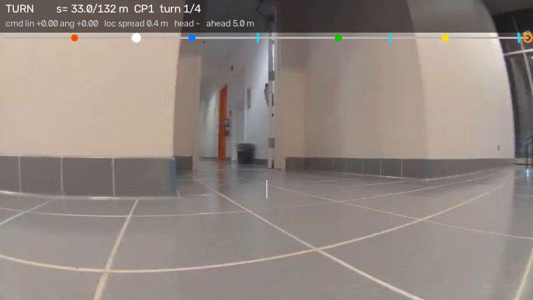

*Mid-turn 1, settling between pulses. No lock yet (`head -`); the next check
compares this view with the teach views down the new corridor.*

### PAUSE and AVOID: a cone in the path

PAUSE holds still for 1.5 s (the operator asked for a visible pause), then AVOID
spins 35° **away** from the cone's side (cone left → pass right), drives straight
at 0.35 for 2 s, and hands back to DRIVE, whose teach heading pulls the rover
back onto the route.

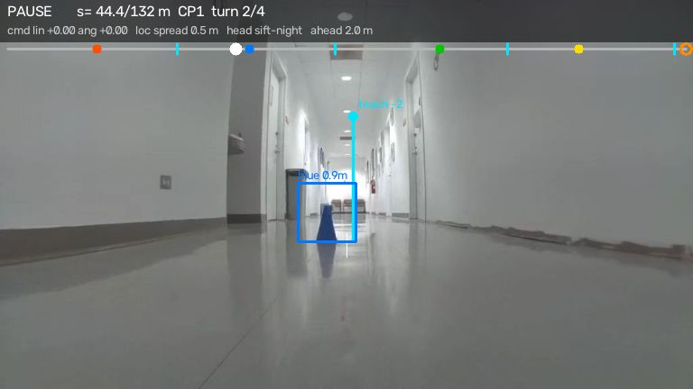

*The blue CP2 cone 0.9 m ahead, dead centre. No floor overlay on this frame:
free space isn't computed on PAUSE ticks.*

### ESCAPE: something is in front

Episode = stop → reverse → look → arc:

1. **Stop** and settle 1.2 s for a fresh frame.
2. If still blocked closer than 1.2 m (or the stuck watchdog forced it),
   **reverse straight back** at −0.4 for 1.5 s (−0.3 for 0.8 s never took
   effect), then settle again.
3. **Look:** fresh free space + teach heading. If ≥ 1.2 m is clear and the teach
   heading is within 10°, go back to DRIVE.
4. Otherwise **arc forward** (0.30 linear, up to ±0.35 angular, 1.6 s) toward the
   clear heading nearest the route. Never spin in place: a counter bug once
   produced four in-place "most open side" spins that turned the rover 178° and it
   drove 5 m the wrong way. Total swing within one episode is capped at ±60° from
   where it began.
5. Nothing clear within the swing limit → reverse again. After more than 4 attempts the rover
   is **boxed in**: hold still 4 s and start over, at most 3 times, then stay put.

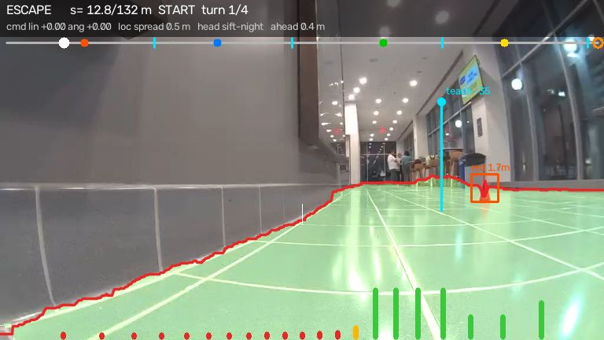

*s = 12.8 m, near CP1: the rover drifted toward the left wall. The red boundary
line hugs it on the left, and the swept strip straight ahead is blocked at
0.40 m (red fan bars on the left). The red CP1 cone is detected 1.7 m away off
to the right, out of the path.*

### SEARCH: lost the heading

Pulses of +25, −50, +75, −100, +125, −150° (so it sweeps ±~75° around the start
direction), checking for a heading after each settle. If found → DRIVE. If all
fail, hold still ("LOST"). One exception: if the rover is within 2 m of the next
corner's start, it takes the corner instead (full lap: at s = 128.3, 1.3 m before
turn 4, it held still facing the black atrium windows).

### FINISH and DONE

The teach lap ends *at* the finish cone, with no map nodes past it. Run 9
stopped ~1 m short of the cone, and run 13 (rolling 1.3 m) overshot it. So on
reaching the map's finish, the rover rolls straight at 0.30 until any one of:
0.6 m of wheel distance, a red/orange cone alongside (< 1.1 m, > 35° off
centre, i.e. crossing the line), one right in front (< 0.5 m), or the floor
ending < 0.6 m ahead. Then DONE, `run.py` exits and halts the rover 3 times.

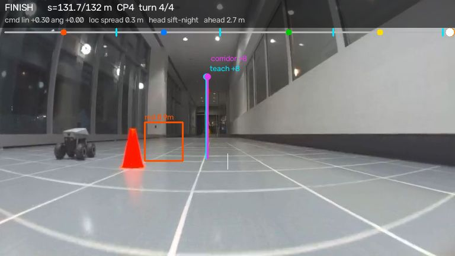

*Rolling past the orange finish cone (left). The other rover is parked there.*

---

## 9. Safety layers: everything that can stop the rover

| Layer | Where | Trigger | Action |
|---|---|---|---|
| Command expiry | `CommandStreamer` | a command's `hold_s` runs out (≤ 0.6 s while driving) | streams zeros |
| Rover watchdog | firmware | commands stop arriving | coasts to a stop |
| Tick exception | `run.py` | any error in `nav.step` | halt, log `ERROR` |
| No frame / slow fetch / stale odometry | `run.py` | no frame, fetch > 4 s, odometry > 2.5 s old while moving | hold zero until data is back |
| Frozen link | `run.py` | image and odometry unchanged 4 s while commanding | hold zero |
| Loop stall | `Navigator._odom_progress` | tick gap > 2 s | ignore odometry across it, re-localize visually |
| Wall / obstacle | DRIVE → ESCAPE | floor ends < 0.6 m, no clear heading | stop, reverse, arc |
| Hung up / no progress | DRIVE → ESCAPE | wheels turn but view frozen; or no wheel progress 6 s | reverse, arc |
| Blind | DRIVE → SEARCH | no heading and no corridor for ~2 s | stop, search pulses, or hold |
| Cone | DRIVE → PAUSE | cone < 1 m in the path | stop 1.5 s, sidestep |
| Boxed in | ESCAPE | 4 escapes without success, ×3 | hold still |
| Run limit | `run.py` | 1500 s | stop |
| Ctrl-C / `kill` | `run.py` | SIGINT, SIGTERM | halt ×3 in `finally` |

---

## 10. What a run leaves behind

`runs/indoor/run_<stamp>/`:

- `log.jsonl`: one line per tick (fields below).
- `frames/NNNNNN.jpg`: every 2nd tick's camera frame at 512 × 288 (`SAVE_FRAMES`).
- `overlay/NNNNNN.jpg`: the annotated view for the same ticks.
- Optional `overlay.mp4`: `python -m erc_indoor.overlay runs/indoor/run_<stamp>` re-renders
  the saved frames with the log (the floor mask is recomputed).

While running, the newest overlay is served at `http://<machine>:8090/stream.mjpg`
(MJPEG, embeddable as ``) and `/latest.jpg`.

**Reading an overlay frame:** green = floor per SegFormer; red line = where the floor
ends in each column; bars along the bottom = clearance per heading (green > 1.6 m,
amber, red < 0.6 m); cyan = teach heading; magenta = corridor axis; orange =
avoidance heading; boxes = cones; top bar = the lap with corners (cyan ticks),
checkpoints (coloured dots), finish (orange ring) and the rover (white dot). The HUD
shows mode, progress, last checkpoint, corner number, the command, localization
spread, which view gave the heading and the clearance ahead.

**`log.jsonl` fields:**

| Field | Meaning |
|---|---|
| `t`, `tick` | wall time, tick number |
| `mode`, `note` | navigator mode and why (e.g. `ref 640 err -7.9 sift-night CORRIDOR->+12`) |
| `lin`, `ang`, `hold` | the command and how long it holds |
| `odo_s`, `odo_yaw`, `v`, `odo_age` | raw odometer: cumulative wheel m, gyro deg, m/s, sample age |
| `node`, `s`, `p`, `spread`, `sim` | localizer estimate: node, metres, progress, uncertainty (m), best similarity |
| `ref`, `ref_src`, `yaw_err`, `head_src`, `inliers` | reference node, day/night view, heading error, method (`sift-day`, `sift-night`, `dino-day(0.14)`…), SIFT inliers |
| `ahead_m`, `avoid_deg`, `corridor_deg` | free space ahead, avoidance heading, corridor heading |
| `turn_k`, `spin_rate` | corners done, learned spin rate |
| `cones`, `checkpoint` | nearest cones (colour, dist, y), last checkpoint passed |

The console prints one summary line per second, every mode change, and tagged
events: `[turn k/4]`, `[checkpoint]`, `[cone]`, `[obstacle]`, `[nav]`, `[LINK]`.

---

## 11. A real lap, tick by tick

`run_20260923_004512` (2026-09-23 00:45, at night): the second uninterrupted full
lap. **5.9 min, all four corners, three obstacle stops, one cone pause, zero SDK
dropouts.**

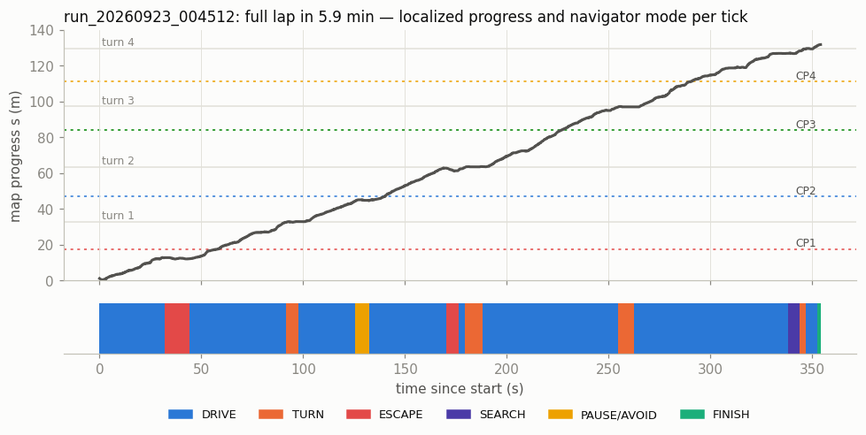

| t (s) | s (m) | What happened |
|---|---|---|
| 0.0 | 1.2 | INIT, 2 ticks, then DRIVE on a night view (`ref 29 err −4.7 sift-night`). |
| 14 | 5.5 | Down the atrium, teach heading only, 5 m of clear floor. 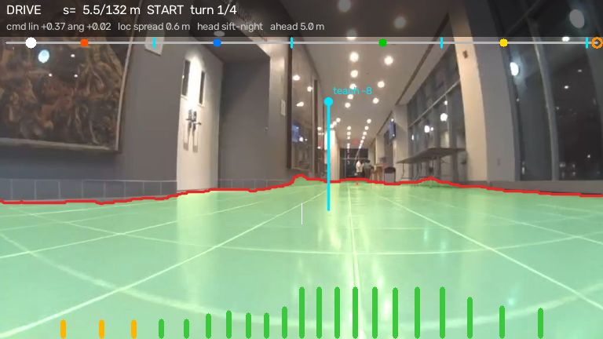 |
| 32–44 | 12.8 | **Escape ×2:** drifted toward the left wall near CP1 (floor ends 0.40 m, then 0.59 m). Stop, reverse, arc −10°, back on track. |
| 58 | 17.5 | Passes CP1. |
| 92–98 | 32.6 → 33.0 | **Turn 1** (piano, left): open-loop +52°, then locks on teach view 479 via DINOv2 (margin 0.12, err −0.8°). Done in ~6 s. |
| 102 | 33.4 | Doorway into the CP2 corridor: avoidance steers +5° off the teach heading. |
| 126–132 | 44.4 | **Cone:** blue CP2 cone 0.9 m ahead, dead centre. Pause 1.5 s, sidestep −35°, pass, realign +40°. |
| 132–170 | 45 → 62 | CP2 corridor on corridor-following most of the way. |
| 171–176 | 62.8 | **Escape:** floor ends 0.53 m before the chairs corner; one arc out. |
| 180–188 | 63.2 → 63.6 | **Turn 2** (left): open-loop +63°, locks on view 793 (SIFT night, −1.9°). |
| 255–263 | 96.9 → 97.0 | **Turn 3** (left): open-loop +49° (75° nominal × 0.65), locks via DINOv2 night (+3.1°). |
| 338–344 | 126.9 | **SEARCH:** heading lost facing the dark atrium windows; within 2 m of turn 4, so it takes the corner early. |
| 344–347 | 128.2 → 129.2 | **Turn 4** (right): open-loop −68°, locks on view 1342 (SIFT night, −5.9°). |
| 353–354 | 131.2 → 131.8 | **FINISH:** rolls 0.6 m past the map end, DONE at the orange cone. |

Over the lap: 1161 ticks DRIVE, 100 TURN, 69 ESCAPE, 22 SEARCH, 26 PAUSE/AVOID.
Of the DRIVE ticks, 1017 steered off SIFT (742 night view, 275 day view), 95 off
DINOv2, and 49 had no teach heading (corridor or free space carried them).

---

## 12. Tuning knobs

Every constant in `run.py` and `navigator.py` is an environment variable with the
default shown. The ones you are most likely to touch:

| Variable | Default | What it does |
|---|---|---|
| `SEND_CONTROL` | 1 | `0` = dry run: everything runs, nothing moves. |
| `START_S` | 0 | Start mid-route at this many metres; corners before it count as done. |
| `STOP_AT_S` | 0 | Stop after this much progress (staged tests); 0 = full lap. |
| `USE_CONES`, `USE_FREESPACE`, `USE_TWIN` | 1 | Turn off the cone pause, obstacle avoidance or night views. |
| `CTRL_HZ` | 4 | Decision rate. |
| `V_NOM`, `V_SLOW`, `LIN_MIN` | 0.45, 0.30, 0.28 | Linear speeds. |
| `KP_DEG`, `KI_DEG`, `MAX_ANG` | 0.006, 0.0015, 0.25 | Steering gains and cap. |
| `ALIGN_DEG` | 30 | Above this heading error, stop and pulse instead of arcing. |
| `LOOKAHEAD_M` | 1.0 | How far ahead the reference view is. |
| `LATENCY_S` | 0.8 | Latency the estimate is pushed forward by. |
| `SPIN_ANG`, `SPIN_RATE_PRIOR`, `SETTLE_S` | 0.55, 25, 1.4 | Pulse strength, initial spin-rate guess, settle time. |
| `TURN_FIRST_FRAC`, `TURN_AIM`, `TURN_TOL_DEG` | 0.65, 0.8, 7 | Open-loop fraction, per-pulse undershoot, alignment tolerance. |
| `STOP_M`, `NEED_M`, `SLOW_M` | 0.6, 1.2, 1.6 | Free-space thresholds: escape, a heading counts as clear, start slowing. |
| `CONE_STOP_M`, `CONE_PAUSE_S`, `CONE_SIDESTEP_DEG` | 1.0, 1.5, 35 | Cone reaction. |
| `FINISH_EXTRA_M` | 0.6 | How far to roll past the map's end. |
| `LINK_STALE_S`, `ODOM_STALE_S`, `SDK_TIMEOUT_S` | 4, 2.5, 3 | Link watchdogs. |
| `SAVE_FRAMES`, `OVERLAY`, `OVERLAY_PORT` | 2, 1, 8090 | Outputs. |
| `ROUTE_MAP` | `data/route_map` | Which map to follow. |
| `SEG_MODEL` | `nvidia/segformer-b2-finetuned-ade-512-512` | Floor segmenter. |

---

## 13. Tools

| Command | Use |
|---|---|
| `python -m erc_indoor.probe` | 1 m live check (needs clear floor): forward 1.5 s, spin left 1 s, spin right 1 s. Prints command→wheel lag, speed at `V_NOM`, and the gyro vs camera rotation of the left spin. A left spin must give a **positive** visual shift. |
| `python -m erc_indoor.record` | Keyboard teach-lap recorder (`w/s` drive, `a/d` spin, `q/e` arc, `space` stop, `+/-` speed, `0`–`4` cone marks, `m` marker, `x` quit). |
| `python -m erc_indoor.route_map [--lap ... --out ...]` | Build a route map from a lap. |
| `python -m erc_indoor.twin [--lap ...]` | Attach night views to the map. |
| `python -m erc_indoor.replay <lap>` | Localize a recorded lap against the map; prints where each cone mark lands and plots the filter vs raw retrieval. `--nav` steps the full navigator open-loop over the recording (commands aren't applied), to check that every code path runs and corners fire where the lap turned. |
| `python -m erc_indoor.overlay <run_dir>` | Render a finished run to `overlay.mp4`. |

`route_map`, `twin` and `replay` need the recorded laps, which are not in git.

---

## 14. Known quirks and weak spots

- **Doorways are the main cost.** Most obstacle stops happen at doorframes (13 in
  one earlier full lap, 3 in the best). The next improvement would be aiming for the
  centre of a doorway gap rather than the nearest clear heading.
- **Teach bias near walls.** SIFT features on a nearby wall shift with sideways
  offset as well as heading, which is why corridor following overrides the teach
  heading in corridors.
- **Night atrium.** With black windows the atrium has few features; the night twin
  and DINOv2 fallback exist for it, and SEARCH near turn 4 still happens there.
  The competition itself is in daylight, where the day map applies directly.
- **Stale comment:** `freespace.py`'s docstring says the camera has "3 deg pitch";
  the measured value in `camera_front.json` (≈ 2.4° up) is the one actually used.
- **Vestigial mode:** `ESCAPE_TURN` is checked in `Navigator.step` but never set.
- **Shared credentials:** if someone else logs into the same bot while a run is
  going, the SDK's messaging session is kicked (`REMOTE_LOGIN`) and the link
  watchdog holds the rover at zero until it recovers. Only one SDK per bot.
